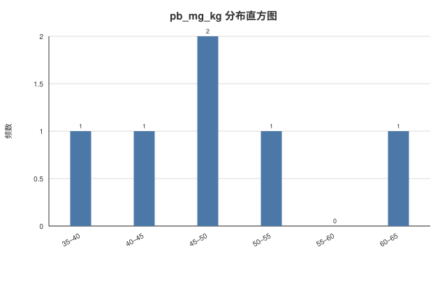
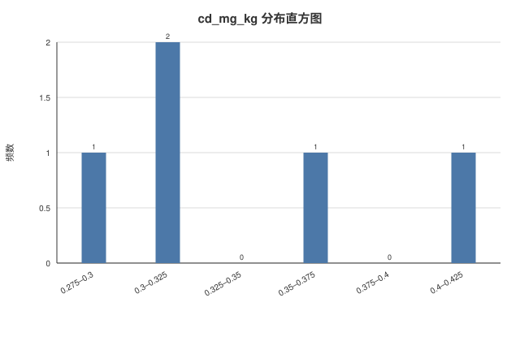
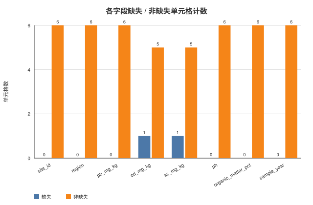
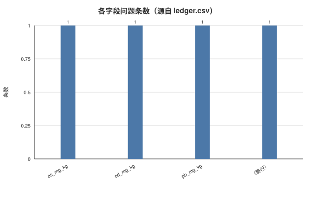
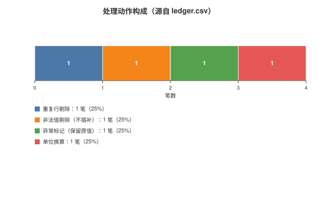

# 数据质量报告：case-synth-soil-001

## 1. 数据概览

- 清洗后数据行数：6
- 字段数：8
- 缺失单元格总数：2
- 整体缺失率：4.17%
- 变更记录条数：4

## 2. 问题清单

### 2.1 按字段统计的问题条数

| 字段 | 问题条数 | 涉及动作 | 涉及行 |
| --- | --- | --- | --- |
| as_mg_kg | 1 | 非法值剔除（不插补） | S05 |
| cd_mg_kg | 1 | 异常标记（保留原值） | S06 |
| pb_mg_kg | 1 | 单位换算 | S04 |
| （整行） | 1 | 重复行剔除 | S02-dup |

### 2.2 按字段统计的缺失情况

| 字段 | 缺失数 | 非缺失数 |
| --- | --- | --- |
| site_id | 0 | 6 |
| region | 0 | 6 |
| pb_mg_kg | 0 | 6 |
| cd_mg_kg | 1 | 5 |
| as_mg_kg | 1 | 5 |
| ph | 0 | 6 |
| organic_matter_pct | 0 | 6 |
| sample_year | 0 | 6 |

## 3. 处理动作与影响范围

| 处理动作 | 动作代码 | 笔数 | 影响字段 |
| --- | --- | --- | --- |
| 重复行剔除 | drop_duplicate | 1 | （整行） |
| 非法值剔除（不插补） | drop_invalid | 1 | as_mg_kg |
| 异常标记（保留原值） | flag_outlier | 1 | cd_mg_kg |
| 单位换算 | unit_convert | 1 | pb_mg_kg |

- 单位换算：1 笔
- 重复行剔除：1 组
- 非法值剔除（不插补）：1 条
- 异常标记（保留原值）：1 条

## 4. 图表

### 图 1：pb_mg_kg 分布直方图

- 图表类型：直方图
- 选择依据：该指标为连续数值型汇总列，需观察取值分布与离群迹象；依据 figure_choice.md「分布 → 直方图」。
- 图注：基于 cleaned.csv 中 pb_mg_kg 列 6 个非缺失数值绘制。

### 图 2：cd_mg_kg 分布直方图

- 图表类型：直方图
- 选择依据：该指标为连续数值型汇总列，需观察取值分布与离群迹象；依据 figure_choice.md「分布 → 直方图」。
- 图注：基于 cleaned.csv 中 cd_mg_kg 列 5 个非缺失数值绘制。

### 图 3：各字段缺失 / 非缺失单元格计数

- 图表类型：分组条形图
- 选择依据：缺失按字段分类计数，属于分类计数对比；依据 figure_choice.md「缺失分类 → 分组条形图」。
- 图注：cleaned.csv 共 6 行 × 8 字段，缺失单元格总数 2。

### 图 4：各字段问题条数

- 图表类型：条形图
- 选择依据：字段问题数为离散计数对比；依据 figure_choice.md「对比 → 条形图」。
- 图注：ledger.csv 共 4 条变更记录，按字段归并计数。

### 图 5：处理动作构成

- 图表类型：堆叠条形图
- 选择依据：展示各类处理动作在全部变更记录中的构成；依据 figure_choice.md「构成 → 堆叠条形图」。
- 图注：ledger.csv 共 4 条变更记录，按动作类型归并。

## 5. 异常与限制说明

- 逐条变更记录见 ledger.csv；不确定项见 result.json 的 uncertainty 字段。
