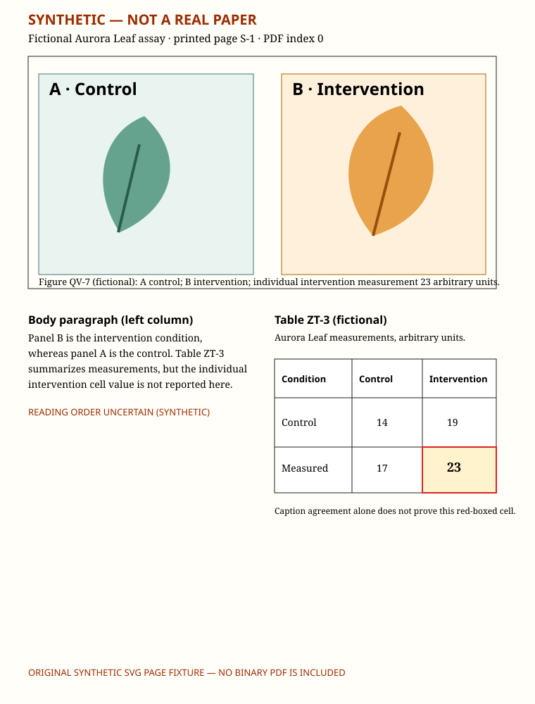
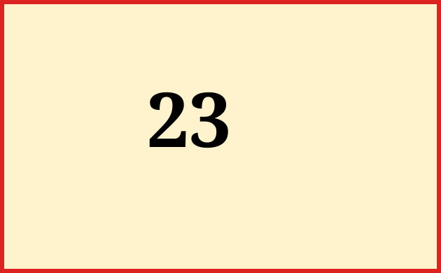

# Visual Evidence Atlas — SYNTHETIC

 **SYNTHETIC — FICTIONAL EVIDENCE, NOT A REAL PAPER.**

- Case: `synthetic-aurora-leaf-qv7-zt3`
- Validation: **partial**
- Machine visual truth verified: **false** (records cannot prove actual sight).
- Coordinates: original-render top-left pixels, `[x0,y0,x1,y1]`, end-exclusive.

## Original pages

### synth-page-000 — PDF index 0; printed page S-1

Source file identity: `fictional-aurora-leaf-supplement.pdf (identity only; no PDF or content inference)`
Reading order: **uncertain**; columns: 2. SYNTHETIC: left body column and right table column must not be assigned order from extraction alone.

[Open original evidence](original_page.svg)

## Original crops

### crop-cell-measured-intervention

Parent region: `reg-cell-measured-intervention`; page: `synth-page-000`; original-page source bbox: `[600, 635, 705, 700]`. Crop pixel dimensions: 630×390.

[Open original crop](original_cell_crop.svg)

## Regions

| ID | Page | Kind | Identity | BBox | Evidence | Source quote |
|---|---|---|---|---|---|---|
| reg-figure-qv7 | synth-page-000 | figure | — | [40, 80, 705, 410] | available | — |
| reg-panel-a | synth-page-000 | panel | panel_label=A | [55, 105, 360, 390] | available | — |
| reg-panel-b | synth-page-000 | panel | panel_label=B | [400, 105, 690, 390] | available | — |
| reg-caption-figure-qv7 | synth-page-000 | caption | — | [40, 395, 705, 425] | available | Figure QV-7. Fictional Aurora Leaf assay: panel A shows the control condition; panel B shows the intervention condition. The corresponding individual intervention measurement is 23 arbitrary units in Table ZT-3. [76:287] |
| reg-body-panel-discussion | synth-page-000 | body_paragraph | — | [40, 445, 350, 600] | available | Body paragraph. Panel B is the intervention condition, whereas panel A is the control. Table ZT-3 summarizes the measurements, but this paragraph does not report the individual intervention cell value. [408:609] |
| reg-caption-table-zt3 | synth-page-000 | caption | — | [390, 445, 705, 500] | available | Table ZT-3. Fictional Aurora Leaf measurements in arbitrary units; column identities are shown in the original table. [289:406] |
| reg-table-zt3 | synth-page-000 | table | — | [390, 510, 705, 700] | available | — |
| reg-table-row-measured | synth-page-000 | table_row | row_label=Measured | [390, 635, 705, 700] | available | — |
| reg-cell-measured-intervention | synth-page-000 | table_cell | row_label=Measured; column_label=Intervention | [600, 635, 705, 700] | available | 23 [665:667] |

## Decisive claims and corroboration

### claim-panel-b-intervention — reviewed_corroborated

SYNTHETIC: Figure QV-7 panel B is the intervention condition.

- Decisive: True; subjects: reg-panel-b
- Inspection: **agent_attested_inspected**; change_record: cr-inspect-panel-b
- Caption: **corroborated** — Figure QV-7. Fictional Aurora Leaf assay: panel A shows the control condition; panel B shows the intervention condition. The corresponding individual intervention measurement is 23 arbitrary units in Table ZT-3. [76:287]
- Body: **corroborated** — Panel B is the intervention condition, whereas panel A is the control. [424:494]
- Resolution basis: agent attestation plus caption and body anchors; not machine visual truth

### claim-cell-measured-intervention-23 — reviewed_corroborated

SYNTHETIC: Table ZT-3 row Measured, column Intervention contains 23 arbitrary units; direct original-cell inspection supports this claim, while absent body corroboration remains a limitation.

- Decisive: True; subjects: reg-cell-measured-intervention
- Inspection: **agent_attested_inspected**; change_record: cr-inspect-cell-23
- Caption: **corroborated** — Figure QV-7. Fictional Aurora Leaf assay: panel A shows the control condition; panel B shows the intervention condition. The corresponding individual intervention measurement is 23 arbitrary units in Table ZT-3. [76:287]
- Body: **not_reported** — —
- Resolution basis: agent-attested direct inspection of an available original table cell with verified row/column identity; caption/body corroboration remains separately recorded and is not machine visual truth

## Unresolved items and warnings

- **READING_ORDER_UNCERTAIN / uncertain**: synth-page-000: double/multi-column reading order is uncertain
- **BODY_CORROBORATION_NOT_REPORTED / not_reported**: claim-cell-measured-intervention-23: direct original-cell evidence remains reviewed; independent body corroboration is absent
