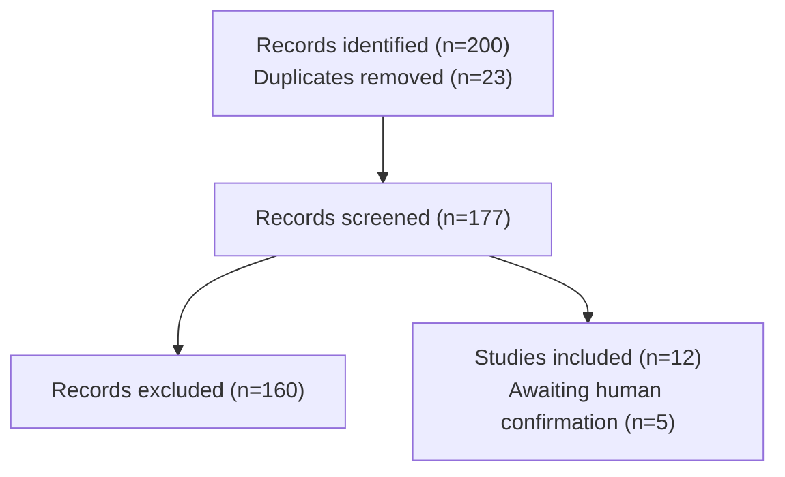

# 系统性文献筛选报告

> 本报告由 build_report.py 从流程产物组装；所有数字可回溯到 counts/protocol/decisions 产物文件，渲染层不生成新数字。

## 1 检索范围
- 检索日期：2026-11-24
- **pubmed**：字段范围 title/abstract [tiab]；日期 [dp]；日期限定 2015-01-01..2026-12-31；语种限定 en
- **scopus**：字段范围 TITLE-ABS-KEY；PUBYEAR；日期限定 2015-01-01..2026-12-31；语种限定 en
- 快照声明：有限快照：检索式按 search_date 限定覆盖范围，不声称实时或全局召回。

## 2 流程计数
| 环节 | n |
|---|---|
| identified | 200 |
| duplicates_removed | 23 |
| screened | 177 |
| excluded | 160 |
| included | 12 |
| needs_human | 5 |

## 3 流程图

| 环节 | n |
|---|---|
| identified | 200 |
| duplicates_removed | 23 |
| screened | 177 |
| excluded | 160 |
| included | 12 |
| needs_human | 5 |

## 4 排除理由分布
| 理由码 | n |
|---|---|
| EX-DESIGN | 80 |
| EX-OUTCOME | 30 |
| EX-POPULATION | 50 |

## 5 双人标注一致性
双人判定 177 条，一致 170 条，一致率 96.0%；分歧处理见仲裁记录。

## 6 待人工确认
待人工确认记录 5 条；在人工回填前其模型判定仅为 pending 建议，不纳入最终结论。

